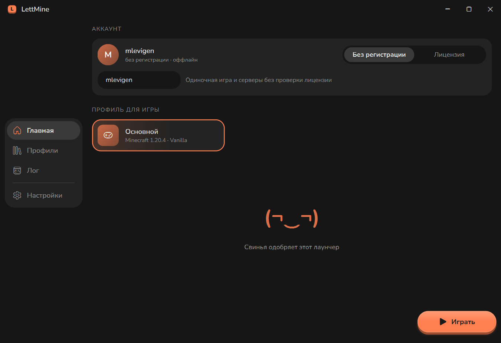

# LettMine

Лаунчер Minecraft: Java Edition для Windows из семейства приложений LettCup.



* **Профили-сборки.** У каждого профиля своя версия игры, загрузчик (Vanilla или Fabric), память, иконка и папка с модами, мирами и настройками. Версии, библиотеки и Java скачиваются один раз и общие для всех профилей.
* **Аккаунт.** Ник без регистрации или вход по лицензии Microsoft.
* **Моды** включаются и отключаются галочками прямо в профиле.
* **Лог** игры и лаунчера во вкладке, без окна консоли.
* **Java** подбирается сама под версию игры.
* Русский и английский интерфейс, акцентный цвет на выбор.

## Установка

1. Установите [Python 3.11 или новее](https://www.python.org/downloads/) с галочкой «Add python.exe to PATH».
2. Скачайте архив `LettMine-<версия>-windows.zip` со страницы [релизов](https://github.com/mLeviGen/lettmine/releases/latest) и распакуйте в любую папку.
3. Запустите `LettMine.bat`. При первом запуске он подготовит окружение (около минуты), дальше лаунчер открывается сразу.
4. Потом запускайте `LettMine.exe`: из него можно сделать ярлык или закрепить на панели задач.

Данные игры хранятся в папке `.lettmine` рядом с лаунчером, настройки — в `app/data/config.json`.

## Вход по лицензии

Нужен Client ID приложения Azure, которому Mojang выдала доступ к Minecraft API:

1. [portal.azure.com](https://portal.azure.com) → Microsoft Entra ID → «Регистрация приложений» → «Новая регистрация».
2. Типы учётных записей — с **личными учётными записями Microsoft**. URI перенаправления — «Общедоступный клиент/собственный (мобильные и классические)», `http://localhost:51735`.
3. Подайте заявку Mojang: [aka.ms/mce-reviewappid](https://aka.ms/mce-reviewappid).
4. Вставьте Client ID в «Настройки → Вход по лицензии».

## Разработка

```powershell
python -m venv .venv
.venv\Scripts\python -m pip install -r requirements.txt
.venv\Scripts\python app.py
```

| Команда | Что делает |
|---|---|
| `tools\make_exe.py` | собирает `LettMine.exe` и ярлык (нужен MinGW: gcc + windres) |
| `tools\make_icon.py` | пересобирает иконки из логотипа |
| `tools\check_i18n.py` | проверяет, что у всех строк есть английский перевод |
| `tools\package.py` | собирает архив релиза в `dist\` |

Правила дизайна (общие для приложений LettCup) — в [docs/DESIGN.md](docs/DESIGN.md).

## Релизы

Версия задаётся в одном месте — `app/version.py`. Чтобы выпустить релиз:

```powershell
git commit -am "LettMine 0.9.1: ..."
git tag v0.9.1
git push --follow-tags
```

GitHub Actions соберёт `LettMine.exe` и архив и опубликует релиз со списком изменений. Тег должен совпадать с версией в `app/version.py`.

## Сторонние компоненты

* [minecraft-launcher-lib](https://codeberg.org/JakobDev/minecraft-launcher-lib), [PyQt6](https://www.riverbankcomputing.com/software/pyqt/).
* Шрифт [Nunito](https://github.com/googlefonts/nunito) — SIL Open Font License 1.1 (`app/assets/fonts/OFL.txt`).

Minecraft — товарный знак Mojang Studios. LettMine — неофициальный лаунчер, не связанный с Mojang и Microsoft.
